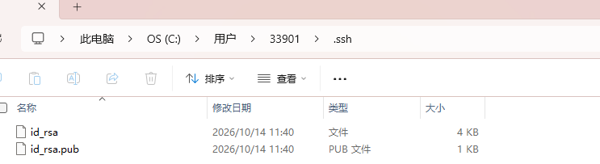
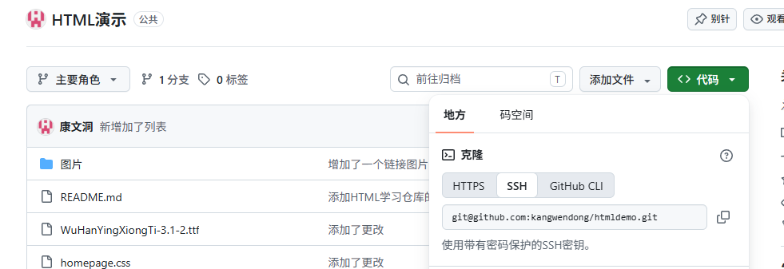

# git_study
学习Web所创建的仓库，此为git学习。
使用git,vscode,与github的使用
 # git官网
https://git-scm.com/,
里面可以下载git和学习相关的知识；

<blockquote>安装 Git 后，你首先应该设置用户名和电子邮件地址。 这很重要，因为每个 Git 提交都会使用这些信息，并且它不可更改地融入你开始创建的提交中： 
$ git config --global user.name "kangwendong"              
$ git config --global user.email kangwendong@example.com           

*kangwendong是用户名，kangwendong@example.com是邮箱，
用户名和邮箱最好与你的github上的名字与邮箱相对应* 
# 安装git好第一步，设置用户名和邮箱，在vscode里使用
打开vscode,新建终端，依次输入 
git config --global user.name "kangwendong" ,回车 
git config --global user.email kangwendong@example.com        
这样你的git就配置好了你电脑所对应的信息，</blockquote>

# 建立个人电脑上的ssh,并与远程仓库相对应
在终端里面设置ssh所需要的命令： 
ssh-keygen -t rsa -b 4096 -C "your_email@example.com"，引号包围的是自己的邮箱，最好是github上的邮箱，然后回车直到出现多列字母，这样就建立好了个人电脑的ssh密钥。
# 如何查看建立好的ssh密钥
C盘/用户/用户名/.ssh文件夹 
 
.pub后缀的就是公钥，没有后缀的就是私钥;用记事本打开公钥，复制里面的代码，打开github设置里面的ssh密钥，新建ssh密钥，这样本地电脑就和远程仓库github绑定了。
<blockquote>公钥和私钥的区别
SSH 使用非对称加密：

私钥（id_rsa）：保存在本地，用于解密和签名，绝不上传。

公钥（id_rsa.pub）：上传到 GitHub，用于验证身份 

GitHub 会信任存放了该公钥的机器，后续在该机器上操作 Git 时无需输入密码。
</blockquote>

# 克隆远程仓库到本地

建立好ssh后就可把github上的代码下载到个人仓库。

<blockquote>
找到远程仓库地址复制，然后在个人电脑新建一个存放的文件夹；进入文件夹后鼠标右键打开git bash或git cmd,输入git命令 
git clone 你想下载的ssh链接 
回车即可下载；
</blockquote>

# 新建文件，仓库初始化
<blockquote>
在vscode里面新建文件，然后在vscode左列的源代码管理中与github账号进行绑定后，初始化仓库，为更改的文件进行一个提交命名，提交后创建了存档，接着再次提交就可把代码提交到仓库。
</blockquote>

# 在vscode中建立代码，以上传到远程仓库。本地代码上传到仓库，网络不好需要用到代理，请查看自己代理的端口号

<blockquote>

简介：你可以用 git config --global http.proxy 或 https.proxy 来设置 Git 代理，例如：git config --global http.proxy http://127.0.0.1:端口号 或 git config --global http.proxy socks5://127.0.0.1:端口号。取消代理用 git config --global --unset http.proxy。

github的全局代理： 
git config --global https.proxy https://127.0.0.1:代理端口数字
 
针对github设置代理：
 git config --global http.https://github.com.proxy socks5://127.0.0.1:代理端口数字
 
<strong>移除代理的命令：git config --global --unset http.https://github.com.proxy</strong> 
<strong>检查代理是否生效：</strong> 
git config --global --list 
取消代理:git config --global --unset http.proxy 
</blockquote>

